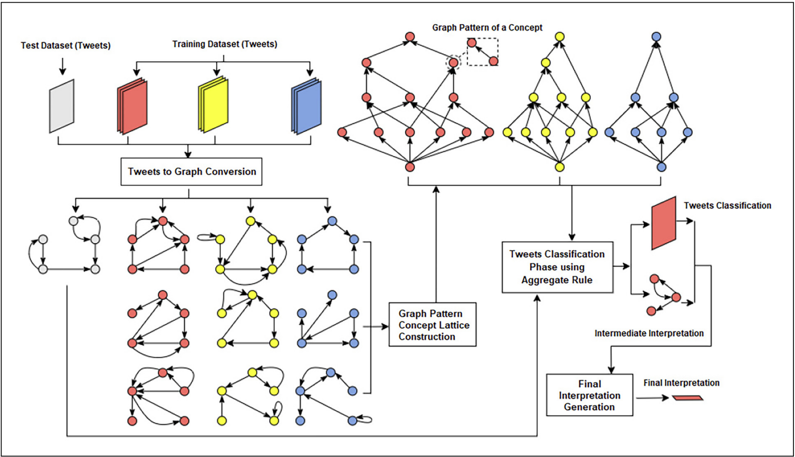
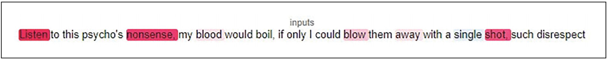
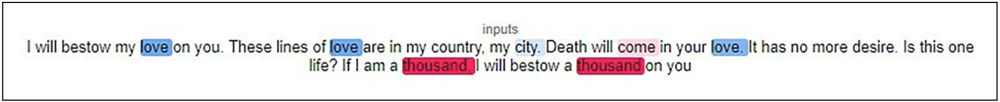

# AMRPR-TTI: Explainable Threat Detection Using AMR Graphs

**English Tweets · Semantic Graphs · Pattern Mining · Intrinsic Explainability**

[](https://www.python.org/)
[](https://jupyter.org/)
[](https://github.com/MSIMALIK/AMRPR-TTI)
[](https://doi.org/10.1177/1088467X251330977)
[](LICENSE)

An explainable Natural Language Processing framework for identifying **threatening English tweets** using **Abstract Meaning Representation (AMR) graphs**, **mined graph patterns**, and an **aggregate classification rule**.

**[Main paper](https://doi.org/10.1177/1088467X251330977) · [Workflow](#workflow) · [Results](#published-results) · [Dataset](Dataset-STTI.xlsx) · [Notebook](XAI_graph_AMR_finale.ipynb) · [Citation](#citation)**

<a name="research-basis"></a>

## 📄 Research basis

This repository accompanies the **2025 Intelligent Data Analysis paper** linked above, which combines AMR graphs and pattern structures for interpretable threat identification. The related studies listed below provide additional context on explainable prediction, transfer learning, and threat targets.

<a name="classification-task"></a>

## 🎯 Classification task

| Label | Class |
| --- | --- |
| `0` | Non-Threatening |
| `1` | Threatening |

The implementation processes **English-language text**. Its graph patterns provide interpretable evidence associated with each class.


<a name="workflow"></a>

## 🔄 Workflow

The framework converts tweets into AMR graphs and constructs graph-pattern concept lattices from the training data. An aggregate rule classifies test tweets, while contributing graph patterns and corresponding text provide intermediate and final explanations.




<a name="methodology"></a>

## ⚙️ Methodology

### Text-to-graph representation

1. Split each tweet into sentence segments.
2. Parse each segment using the **amrlib BART-based AMR parser**.
3. Replace AMR variable identifiers with concepts and remove instance triples.
4. Lowercase and lemmatize graph node labels.
5. Merge the sentence graphs into a tweet-level graph, removing duplicate triples.
6. Export the graphs and their vocabulary mapping for pattern mining.

### Pattern mining and classification

**gSofia**, obtained separately, mines patterns from the training graphs for each class. The notebook computes an aggregate score from matching patterns, using their support, size, and a penalty derived from patterns of the opposing class.

For each class, pattern contributions are normalized by the sum of that class's pattern supports. The notebook also tracks a highest-contributing pattern for visualization.

### 🧩 AMR Graph-Based Explanations

The explanation is connected to the graph patterns used in scoring. Inspecting their concepts and relations helps show which semantic structures support a prediction.

AMR parsing and graph refinement determine what information reaches the classifier. A visualized pattern is evidence about the model's decision and should be interpreted together with the original tweet.

### 🔎 SHAP Word-Level Comparisons

The paper uses SHAP word-level explanations to compare with the proposed framework's intrinsic AMR explanations. Red highlights support the threatening class, while blue highlights support the non-threatening class; stronger shading indicates a larger contribution.

#### 🔴 Threatening Tweet



SHAP highlights influential words in the threatening example (Figure 8 of the paper).

#### 🔵 Non-Threatening Tweet



SHAP shows opposing word contributions in the non-threatening example (Figure 10 of the paper).

<a name="baseline-experiments"></a>

## 🧪 Baseline experiments

| Component | Methods included |
| --- | --- |
| Classifiers | `SGDClassifier` with perceptron loss, `KNeighborsClassifier`, `GaussianNB` |
| Feature representations | Word unigrams, Word2Vec, FastText, LIWC categories |
| Data split | Stratified 90:10 train/test split with `random_state=42` |
| Evaluation | Precision, recall, F1-score, classification reports, and baseline confusion-matrix counts |

<a name="published-results"></a>

## 📊 Published results

The following scores are reported in **Tables 5 and 6 of the [main paper](https://doi.org/10.1177/1088467X251330977)** for its 90:10 train/test experiment. They are published results, not scores independently reproduced by running this repository.

### Proposed framework

The **Text-to-graph + Aggregate rule** method reports **73.15% accuracy**. Its class-wise and average metrics are shown below; precision, recall, and F1 are percentages.

| Class / average | Precision (%) | Recall (%) | F1-score (%) | Support |
| --- | ---: | ---: | ---: | ---: |
| Threatening | 71.67 | 78.18 | **74.78** | 55 |
| Non-Threatening | 75.00 | 67.92 | 71.29 | 53 |
| Macro average | 73.33 | 73.05 | **73.03** | 108 |
| Weighted average | 73.30 | 73.15 | **73.07** | 108 |

*Source: Table 5, printed page 1511. Support is the number of evaluated examples.*

### Selected baseline comparison

This table includes the highest-accuracy configuration from each baseline classifier family in Table 6.

| Method | Feature representation | Accuracy (%) | Threat F1 (%) | Non-Threat F1 (%) | Macro F1 (%) |
| --- | --- | ---: | ---: | ---: | ---: |
| SGD classifier | Word unigram | 65.00 | 71.62 | 54.35 | 62.98 |
| Naive Bayes | Word unigram | 62.50 | 68.97 | 52.63 | 60.80 |
| K-nearest neighbors | Word2Vec | 65.83 | 72.11 | 55.91 | 64.01 |
| **AMRPR-TTI** | **Text-to-graph + Aggregate rule** | **73.15** | **74.78** | **71.29** | **73.03** |

*Source: selected rows from Table 6, printed page 1511; the paper reports twelve baseline configurations in total.*

**Evaluation context:** Table 5 reports results for **108 examples** (55 threatening and 53 non-threatening). The current notebook filters its graph-method classification report to examples with nonzero scores for both classes. Report the full test-set size and evaluated coverage when reproducing these results, and use the same evaluated examples for a coverage-matched baseline comparison. The published comparison above does not establish that such matching was performed.

<a name="repository-contents"></a>

## 📁 Repository contents

| File | Purpose |
| --- | --- |
| [README.md](README.md) | Project overview, setup, and references |
| [data/Dataset-STTI.xlsx](data/Dataset-STTI.xlsx) | Provided tweet dataset with `Tweets` and `label` columns |
| [notebooks/XAI_graph_AMR_finale.ipynb](notebooks/XAI_graph_AMR_finale.ipynb) | Graph preparation, pattern scoring, explanation visualization, and baseline experiments |
| [LICENSE](LICENSE) | MIT license |

Parser weights, generated graph files, mined pattern files, and the LIWC dictionary are not included.

<a name="installation-and-setup"></a>

## 🚀 Installation and setup

### 1. Clone the repository

```bash
git clone https://github.com/MSIMALIK/AMRPR-TTI.git
cd AMRPR-TTI
```

### 2. Create an environment and install dependencies

```bash
python -m venv .venv

# Linux / macOS

source .venv/bin/activate

# Windows PowerShell: use this activation command instead

# .venv\Scripts\Activate.ps1

python -m pip install amrlib torch transformers sentencepiece pandas numpy openpyxl scikit-learn nltk penman tqdm emoji graphviz gensim spacy liwc Unidecode jupyter
```

This command lists the notebook dependencies; their versions are not locked. Retain a tested environment's package versions when reproducing experiments.

Install the **Graphviz application** separately and ensure its `dot` executable is on your system path. The Python `graphviz` package is the interface to that application.

### 3. Download the AMR parser

Download and extract the model referenced by the notebook:

```bash
wget https://github.com/bjascob/amrlib-models/releases/download/parse_xfm_bart_base-v0_1_0/model_parse_xfm_bart_base-v0_1_0.tar.gz
tar -xzf model_parse_xfm_bart_base-v0_1_0.tar.gz
```

A GPU can reduce AMR parsing time. The notebook also downloads NLTK resources during setup.

### 4. Configure the provided dataset

The original loading cell expects `Threat_translated_into_English.xlsx` and a `Translated` column. **Replace that entire loading and column-cleaning cell** with the following to use the included dataset:

```python
import pandas as pd

df = pd.read_excel(
    "Dataset-STTI.xlsx",
    usecols=["Tweets", "label"],
).rename(columns={"Tweets": "Text", "label": "Label"})

df.head()
```

Replacing the complete cell also removes its original attempt to drop columns that the provided dataset may not contain.

For local execution from the repository directory, update the parser path:

```python
stog = amrlib.load_stog_model(
    model_dir="model_parse_xfm_bart_base-v0_1_0"
)
```

Adjust paths if your runtime stores these files elsewhere.

### 5. Prepare graphs and mine patterns

Run the graph preparation cells. They generate:

| File | Contents |
| --- | --- |
| `threat_train_90.txt` | Threatening training graphs |
| `non_threat_train_90.txt` | Non-threatening training graphs |
| `threat_test_90.txt` | Threatening test graphs |
| `non_threat_test_90.txt` | Non-threatening test graphs |
| `dict_vocab.txt` | Pickled vocabulary-to-ID mapping |

Use **gSofia** to mine patterns from the **training graphs**. The notebook does not include an automatic gSofia installation or execution step.

The classification cells expect these pattern files:

```text
PATTERNS_THREAT43.OUT
PATTERNS_NONTHREAT22.OUT
```

Replace those filenames with your actual mining outputs. Also update the test-graph loading calls to match the generated files:

```python
t_test_graph, _ = read_file("threat_test_90.txt")
nt_test_graph, _ = read_file("non_threat_test_90.txt")
```

### 6. Run classification, explanations, and baselines

```bash
jupyter notebook XAI_graph_AMR_finale.ipynb
```

After preparing the required files, run aggregate scoring and graph visualization. Run the baseline sections separately for the feature representations you want to evaluate.

The LIWC baseline additionally requires **`LIWC2007_English080730.dic`**, obtained separately and supplied at the configured path.

<a name="evaluation-coverage"></a>

## 📋 Evaluation coverage

The current graph-method classification report includes only test examples with **nonzero scores for both classes**. Its metrics therefore describe an evaluated subset of the test partition.

When reporting these metrics, include the full test-set size, the evaluated subset size, and the excluded count. This makes the coverage visible when comparing the graph method with baseline predictions.

For reproduction, retain the data split, parser version, graph transformations, mining parameters, pattern files, and package versions alongside the evaluation outputs.

<a name="citation"></a>

## 📚 Citation

Please cite the main paper when using this framework:

```bibtex
@article{malik2025amrprtti,
  title   = {Explainable threatening tweets identification using abstract meaning representation graph and pattern structure approaches},
  author  = {Malik, Muhammad Shahid Iqbal and Nazarova, Anna and Jamjoom, Mona Mamdouh},
  journal = {Intelligent Data Analysis},
  volume  = {29},
  number  = {6},
  pages   = {1501--1519},
  year    = {2025},
  doi     = {10.1177/1088467X251330977},
  url     = {https://doi.org/10.1177/1088467X251330977}
}
```

<a name="related-research"></a>

## 🔗 Related research

These studies concern explainable threat prediction, Urdu threat targets, and multilingual transfer learning. They are related work rather than additional implementations claimed by this repository.

1. **Anna Nazarova, Muhammad Shahid Iqbal Malik, Dmitry I. Ignatov, and Ibrar Hussain.** (2024). [Deepthreatexplainer: a united explainable predictor for threat comments identification on Twitter](https://doi.org/10.1007/s13278-024-01389-5). *Social Network Analysis and Mining*, **14**, 228.

2. **Muhammad Shahid Iqbal Malik.** (2024). [Threatening Expression and Target Identification in Under-Resource Languages Using NLP Techniques](https://doi.org/10.1007/978-3-031-54534-4_1). In *Analysis of Images, Social Networks and Texts*, AIST 2023, Lecture Notes in Computer Science, **14486**, 3–17. Springer.

3. **Muhammad Rehan, Muhammad Shahid Iqbal Malik, and Mona Mamdouh Jamjoom.** (2023). [Fine-Tuning Transformer Models Using Transfer Learning for Multilingual Threatening Text Identification](https://doi.org/10.1109/ACCESS.2023.3320062). *IEEE Access*, **11**, 106503–106515.

4. **Muhammad Shahid Iqbal Malik, Uswa Cheema, and Dmitry I. Ignatov.** (2023). [Contextual Embeddings based on Fine-tuned Urdu-BERT for Urdu threatening content and target identification](https://doi.org/10.1016/j.jksuci.2023.101606). *Journal of King Saud University – Computer and Information Sciences*, **35**(7), 101606.

<a name="content-notice"></a>

## ⚠️ Content notice

The dataset contains threatening or sensitive expressions used for training and evaluating threat-identification methods. This content is included for research and academic purposes.

<a name="license"></a>

## 📜 License

Project code is licensed under the **MIT License**. See [`LICENSE`](LICENSE). Consult the respective sources for terms applying to external models, dictionaries, data, and papers.

<a name="repository-owner"></a>

## 👤 Repository owner

**Muhammad Shahid Iqbal Malik**  
GitHub: [@MSIMALIK](https://github.com/MSIMALIK)
